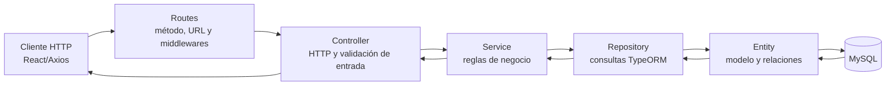
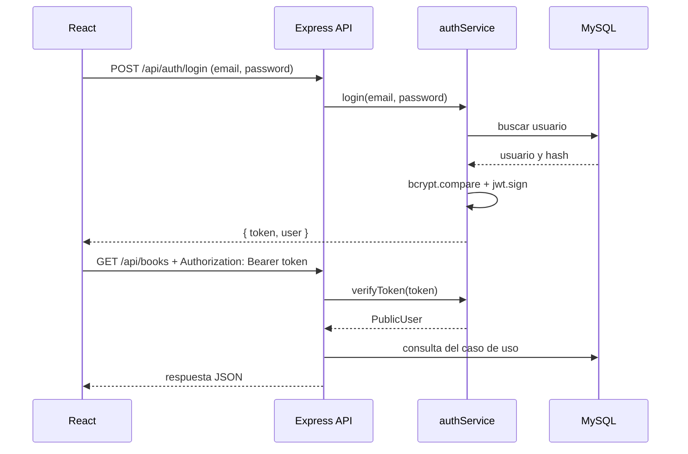

# Arquitectura del backend

Este documento describe cómo está organizada la API de la biblioteca y qué sucede desde que llega una petición HTTP hasta que se responde al cliente. El backend está construido con Node.js, Express 5, TypeScript, TypeORM y MySQL.

## 1. Flujo y stack de módulos

La API separa la entrada HTTP, las reglas de negocio y el acceso a datos. Una operación de libros permite ver el patrón con claridad: `book.routes.ts` enlaza la URL con una función del controller, el controller convierte y valida los datos recibidos, el service aplica las reglas del dominio y el repository usa TypeORM para consultar MySQL.



### Responsabilidad por capa

| Capa | Responsabilidad | Ejemplo en el proyecto |
|---|---|---|
| **Request / cliente** | Envía método, URL, cabeceras y, cuando corresponde, cuerpo o parámetros. | `GET /api/books?autorId=1`; una ruta privada también lleva `Authorization: Bearer <token>`. |
| **Routes** | Declara rutas y asocia métodos HTTP con controllers. También aplica middlewares por ruta o por grupo. | `book.routes.ts` aplica `router.use(authenticateToken)` antes de `GET`, `POST`, `PUT` y `DELETE`. |
| **Controller** | Adapta HTTP al caso de uso: lee `req`, interpreta parámetros y cuerpo, llama al service y construye la respuesta y el status HTTP. | `createBook` convierte el body con `parseInput`, llama a `bookService.createLibro` y devuelve `201`. |
| **Service** | Contiene reglas del dominio y coordina operaciones, sin ocuparse de detalles de Express. | `book.service.ts` verifica que autor, género, estante y saga referenciados existan antes de guardar. |
| **Repository** | Centraliza operaciones de persistencia y consultas mediante el repositorio de TypeORM. | `book.repository.ts` define `findAll`, `findById`, `create`, `update` y `delete`. |
| **Entity** | Describe cómo una entidad del dominio se representa en la base: columnas, claves y relaciones. | `Book` declara `@Entity("books")`, columnas y relaciones `ManyToOne` con autor, género, estante y saga. |
| **DB** | Persiste los registros y aplica restricciones como unicidad y claves foráneas. | MySQL recibe las consultas generadas por TypeORM. |
| **Response** | Devuelve al cliente el status HTTP y datos JSON o, en caso de error, una forma de error uniforme. | Una operación exitosa suele responder `{ success: true, data }`; los errores responden `{ success: false, error }`. |

### Recorrido concreto: crear un libro

1. El cliente envía `POST /api/books` con JSON. Es una ruta privada: antes de ejecutar el controller, `authenticateToken` comprueba el JWT.
2. `createBook` en `book.controller.ts` llama a `parseInput`. Este helper obtiene el body y valida campos como título, año e identificadores.
3. El controller llama a `bookService.createLibro(data)`.
4. El service consulta los repositorios de autores, géneros, estantes y, si se indicó, sagas. Si una referencia no existe, genera un `AppError` de validación.
5. Si las referencias son válidas, el service pide al `bookRepository` guardar el libro. El repository obtiene el repositorio TypeORM de `Book` y ejecuta `save`.
6. El service vuelve a buscar el libro para devolverlo con sus relaciones pobladas.
7. El controller responde `201 Created` con `{ success: true, data }`. Si algo falla, `asyncHandler` pasa el error al middleware global.

Por ejemplo, el repository define sus relaciones que se incluirán en la consulta:

```ts
const RELATIONS = { autor: true, genero: true, estante: true, saga: true } as const;

findById: (id: number) =>
  repo().findOne({ where: { id }, relations: RELATIONS }),
```

El controller mantiene el conocimiento HTTP en su propia capa:

```ts
export const createBook = asyncHandler(async (req, res) => {
  const data = await bookService.createLibro(parseInput(req));
  res.status(HTTP_STATUS.CREATED).json({ success: true, data });
});
```

### ¿Por qué Controllers y Services están separados?

El controller se ocupa del protocolo HTTP: `req`, `res`, códigos de estado, parámetros y formato de la respuesta. El service se ocupa de la lógica del dominio: por ejemplo, comprobar referencias antes de guardar un libro. Así, una regla de negocio no queda mezclada con detalles de Express y puede ser reutilizada desde otro punto de entrada o probada con menos dependencia del transporte.

En términos prácticos, el controller **coordina la entrada y salida HTTP** y delega el trabajo en el service. Esto se conoce principalmente como separación de responsabilidades. No conviene describirlo como una implementación formal de inversión de control: el proyecto importa y usa servicios exportados directamente; no se observa un contenedor de inyección de dependencias. La separación facilita sustituir dependencias y probar capas, pero por sí sola no equivale a usar un framework de IoC.

### ¿Por qué los Repositories interactúan con la base?

El repository es el límite entre la lógica del dominio y la persistencia. En este proyecto, cada repository obtiene un `Repository<Entity>` de `AppDataSource` y delega en TypeORM operaciones como `find`, `findOne`, `save`, `update` y `delete`. TypeORM traduce esas operaciones al dialecto de MySQL; el repository no construye SQL manual en los ejemplos mostrados.

Esto evita que controllers o services dependan de detalles de consultas SQL. Las entidades dan el mapeo objeto-relacional, los repositories ejecutan consultas y MySQL conserva los datos y aplica restricciones.

## 2. Middlewares y validación

En Express, un middleware puede inspeccionar o modificar la petición, finalizar la respuesta o pasar el control al siguiente middleware con `next()`. El orden de registro importa: la petición atraviesa los middlewares globales y luego la ruta correspondiente; los manejadores de error se colocan al final.

### Autenticación JWT: `authMiddleware.ts`

El middleware exporta `authenticateToken`. Busca `Authorization`, separa el esquema del token y exige que el esquema sea `Bearer`. Luego delega la verificación criptográfica y de expiración en `authService.verifyToken`; si el token es válido, agrega el usuario público a `req.user` y llama a `next()`. Si falta o no es válido, lanza un error `401` y la ruta protegida no llega al controller.

```ts
const header = req.headers.authorization;
if (!header) {
  throw AppError.unauthorized("Token de autenticación no proporcionado");
}

const [scheme, token] = header.split(" ");
if (scheme?.toLowerCase() !== "bearer" || !token) {
  throw AppError.unauthorized("Formato inválido. Use: Authorization: Bearer <token>");
}

req.user = authService.verifyToken(token);
next();
```

Las rutas de libros aplican el middleware al router completo, mientras que el login permanece público:

```ts
router.use(authenticateToken);
router.get("/", getBooks);
router.post("/", createBook);
```

La ruta `POST /api/auth/login` no necesita token; `GET /api/auth/me` sí lo requiere.

### Errores globales: `errors.ts`

El archivo define `AppError`, una clase para errores esperados del sistema que lleva status HTTP, código, mensaje y detalles opcionales. `notFoundHandler` transforma rutas no definidas en errores `404`. Después, `errorHandler` normaliza errores conocidos, los registra y responde con una estructura consistente.

Además de `AppError`, normaliza JSON mal formado y algunos errores de MySQL: entrada duplicada (`409`) y eliminación de un registro que sigue referenciado (`409`). Para errores inesperados devuelve un `500` genérico y no expone detalles internos en producción. Si los headers ya se enviaron, delega el error con `next(err)` en lugar de intentar una segunda respuesta.

Los controllers asíncronos se envuelven con `asyncHandler`, que reenvía rechazos de promesas al flujo de errores de Express:

```ts
export const asyncHandler =
  (fn: AsyncController): RequestHandler =>
  (req, res, next) => {
    Promise.resolve(fn(req, res, next)).catch(next);
  };
```

En `index.ts` el orden relevante es:

```ts
app.use(notFoundHandler);
app.use(errorHandler);
```

Por eso el manejador global queda después de todas las rutas. Centralizar la conversión y presentación de errores evita repetir el mismo `try/catch` y el mismo formato JSON en cada controller. El manejador evita que errores de una petición queden sin tratar; no debe interpretarse como garantía de que cualquier fallo fatal del proceso siempre se pueda recuperar.

### Validación de datos: detalle importante del proyecto

En el backend **no hay un `validation.middleware.ts` ni se usa Yup/Zod**. La validación ocurre en helpers de `backend/src/utils/validators.ts`, invocados por los controllers antes de llamar a los services. Por ejemplo, `requiredString` exige texto no vacío, recorta espacios y controla longitud; `requiredInt` valida un entero y su rango; `parseId` valida los identificadores de URL. Las reglas de negocio, como comprobar que exista el autor de un libro, quedan en el service.

Esta secuencia distingue dos niveles:

```text
Controller: forma y tipo de los datos recibidos
      ↓
Service: coherencia con el dominio y existencia de referencias
      ↓
Repository / DB: persistencia y restricciones
```

En el frontend sí se usa Yup (ver `frontend/src/utils/validators.js`) para dar feedback temprano en formularios. Esa validación mejora la experiencia, pero no sustituye la validación del backend: una petición HTTP puede enviarse sin pasar por la interfaz React.

### CORS

`index.ts` registra la función `cors` como middleware global, antes de las rutas. La configuración actual permite el origen exacto `http://localhost:5173` y `credentials: true`. CORS es una política del navegador que controla si una página de otro origen puede leer respuestas de la API; no autentica al usuario ni reemplaza JWT.

```ts
app.use(cors({
  origin: "http://localhost:5173",
  credentials: true,
}));
```

Si cambia el origen del frontend (host, esquema o puerto), hay que ajustar la configuración según el entorno. En este proyecto el cliente Axios envía JWT en una cabecera `Authorization`; CORS y autenticación cumplen funciones distintas.

## 3. Autenticación con JWT

El login se procesa en `user.service.ts`. Primero se busca al usuario por email normalizado y se compara la contraseña con el hash bcrypt almacenado. Si el usuario no existe o la contraseña no coincide, se devuelve el mismo error de credenciales para ambos casos. Si coincide, se firma un JWT.

```ts
jwt.sign(
  { email: user.email, nombre: user.nombre },
  ENV.JWT_SECRET,
  {
    subject: String(user.id),
    expiresIn: JWT_EXPIRES_IN,
    algorithm: "HS256",
  },
);
```

El token contiene claims estándar (`sub`, donde se coloca el ID del usuario, y `exp`, generada por la biblioteca a partir de la expiración) y los claims propios `email` y `nombre`. **No contiene `userId` como claim separado ni `role`**: el identificador está representado por `sub`, y la entidad `User` actual tampoco declara un campo de rol. Por lo tanto, la defensa debe describir la autenticación implementada, no atribuirle autorización por roles que el código no realiza.

`ENV.JWT_SECRET` se utiliza como clave de firma. La API la exige en el entorno al cargar las constantes. En cada solicitud protegida, `jwt.verify` comprueba la firma, restringe el algoritmo a `HS256` y verifica la expiración. El servicio también valida que el payload tenga `sub`, `email` y `nombre` con tipos esperados antes de producir el `PublicUser` que se guarda en `req.user`.

El flujo de sesión, de punta a punta, es:



Un JWT firmado no cifra por sí mismo el contenido: los claims pueden ser decodificados por quien tenga el token. Por eso no deben incluirse contraseñas ni secretos en el payload; la firma sirve para detectar modificaciones y la expiración limita la vigencia.

## 4. Constantes y configuración centralizada

`backend/src/constants/index.ts` carga `dotenv/config` y expone `ENV`, códigos de estado HTTP, códigos y mensajes de error, rondas de bcrypt y expiración del JWT. La función `required` detiene el arranque con un mensaje explícito si falta una variable obligatoria, como `DB_USER`, `DB_NAME`, `JWT_SECRET` o `ADMIN_PASSWORD`.

Centralizar esta configuración ofrece un punto común para revisar los valores y sus defaults, evita repetir cadenas y números en muchos módulos, y facilita cambiar el entorno sin editar la lógica de negocio. Los secretos deben venir de variables de entorno y no guardarse en el repositorio.

Hay que tener presente un detalle concreto al exponer el código: aunque `ENV` declara `DB_PASSWORD`, `backend/src/database/data-source.ts` configura TypeORM leyendo directamente `process.env.DB_PASS`. Esos nombres no coinciden. Al preparar o ejecutar la aplicación se debe verificar qué variable espera el entorno real y alinear esa lectura; la constante centralizada no se usa actualmente para la contraseña en `AppDataSource`.

Otro valor centralizado es `JWT_EXPIRES_IN = "8h"`. `PORT` tiene fallback `3000`, y la conexión requiere `DB_USER` y `DB_NAME`. La inicialización crea `AppDataSource`, ejecuta los seeders y recién entonces abre el servidor. TypeORM está configurado con `synchronize: true`, por lo que sincroniza el esquema según las entidades al iniciar; esto es cómodo para un proyecto educativo, pero en sistemas con datos críticos suele preferirse un esquema controlado mediante migraciones.
